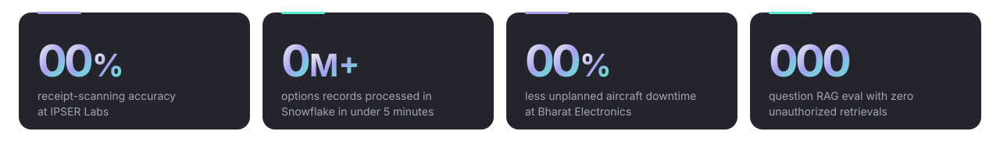

  
  
  
   
  
  
  

### Hi, I'm Likhith

**I work between the model and the data: getting messy inputs into shape, building the service around a model, and checking the results hold up.**

I'm an AI/ML engineer finishing my MS in Information Systems at Northeastern University. I build LLM products and RAG systems from end to end, along with the data pipelines behind them.

- **Most recently:** AI/ML Engineering Intern at IPSER Labs (Jan – Jun 2026), the main backend engineer on a smart pantry app and its LLM features.
- **Before that:** Data Engineer Intern at Bharat Electronics Limited and Data Analyst Intern at Compsoft Technologies.
- **Certified:** AWS Certified Machine Learning Engineer – Associate · Salesforce Certified AI Associate
- **Next:** open to full-time AI/ML, LLM and data engineering roles from January 2027.

### My journey

### Featured projects

<table>
<tr>
<td width="50%" valign="top">

<b><a href="https://github.com/LikhithNG/youtube-trending-data-pipeline-aws">YouTube Trending Data Pipeline on AWS</a></b> 
Oct 2026
 

Built a medallion pipeline on AWS that pulls live YouTube trending data for 10 regions and refines it into Bronze, Silver and Gold tables with PySpark on Glue.

<code>Lambda</code> <code>S3</code> <code>Glue PySpark</code> <code>Step Functions</code> <code>Athena</code>
</td>
<td width="50%" valign="top">

<b><a href="https://github.com/LikhithNG/TravelBuddy">TravelBuddy: Multi-Agent Travel Planner</a></b> 
Dec 2025
 

Built a multi-agent travel planner on LangGraph and GPT-4o: a root agent routes each request to 1 of 3 specialist agents, by keyword rules first and an LLM as fallback.

<code>React</code> <code>FastAPI</code> <code>LangGraph</code> <code>GPT-4o</code> <code>FastMCP</code>
</td>
</tr>
<tr>
<td width="50%" valign="top">

<b><a href="https://github.com/LikhithNG/medvault">MedVault: Medical Records and Bill Checker</a></b> 
Oct 2026 · <a href="https://medvault-wpcblvckvi6rzg9sk345eq.streamlit.app/">try the app ↗</a>
 

Built a phone-first vault for prescriptions, reports and hospital bills: Gemini and open models on Groq read each page, and every record is badged with its source.

<code>Streamlit</code> <code>Gemini</code> <code>Groq</code> <code>Turso</code> <code>CMS APIs</code>
</td>
<td width="50%" valign="top">

<b><a href="https://github.com/LikhithNG/New-Greek-shield-">Greek Shield: AI-Enhanced Options Risk Intelligence</a></b> 
Aug 2025
 

Moved 1M+ options records from AWS S3 through a 6-layer Snowflake medallion architecture in under 5 minutes, cutting market-data preparation time by 70%.

<code>AWS S3</code> <code>Snowflake UDFs</code> <code>Cortex agents</code> <code>LLM agents</code> <code>Streamlit + Slack</code>
</td>
</tr>
<tr>
<td width="50%" valign="top">

<b><a href="https://likhith-ng-portfolio.vercel.app/#proj-finsight">FinSight: RBAC RAG Chatbot</a></b> 
Dec 2025
 

Built a financial RAG chatbot that sends structured questions to DuckDB and document questions to Chroma, with document-level access control across 6 user roles.

<code>FastAPI</code> <code>DuckDB</code> <code>Chroma</code> <code>GPT-4o</code> <code>Cohere</code>
</td>
<td width="50%" valign="top">

<b><a href="https://likhith-ng-portfolio.vercel.app/#proj-transit">Real-Time Public Transit Analytics Lakehouse</a></b> 
Dec 2025
 

Built a real-time lakehouse pipeline that processed 10M+ transit records at 1,000+ events per second with sub-5-second latency for live service monitoring.

<code>Kafka</code> <code>Spark</code> <code>dbt</code> <code>BigQuery</code> <code>Power BI</code>
</td>
</tr>
</table>

#### More projects

| Project | What it is |
|---|---|
| [**MindNet**](https://likhith-ng-portfolio.vercel.app/#proj-mindnet) · May 2025 | A multi-task mental health conversational model that runs locally, trained on 25,000+ labeled interactions: 88% accuracy and 0.84 macro-F1 across intent and emotion. |
| [**Graph-Based EEG Seizure Detection**](https://likhith-ng-portfolio.vercel.app/#proj-eeg) · Feb 2025 | 1,000+ EEG recordings from 200+ patients turned into graph features that capture how electrodes relate in space and how seizure patterns change over time. |
| [**Smart Hydroponic Farm Management**](https://github.com/LikhithNG/DMDD-project-team_17) · Dec 2024 | A normalized Oracle database for 3 simulated farms tracking 50,000+ crop, nutrient, environmental, inventory and harvest transactions. |
| [**AbDiffuser**](https://likhith-ng-portfolio.vercel.app/#proj-abdiffuser) | A diffusion pipeline that generates antibody sequences and 3D structures together, reproducing the APMixer architecture and its SE(3)-equivariant design. |

All ten projects, with drawings of how each one works, are on <a href="https://likhith-ng-portfolio.vercel.app/#projects">my portfolio</a>.

### Writing

- [**Evaluating a RAG system when access control matters**](https://likhith-ng-portfolio.vercel.app/writing/evaluating-rag-with-access-control/): what FinSight taught me about routing questions to the right store, enforcing permissions at retrieval time, and why leakage is a count, not a percentage.
- [**Making an LLM layer provider-agnostic**](https://likhith-ng-portfolio.vercel.app/writing/provider-agnostic-llm-layer/): how I put Claude in production and Ollama in development behind one interface at IPSER Labs, with structured outputs as the contract.
- [**A mental-health chatbot that knows when not to generate**](https://likhith-ng-portfolio.vercel.app/writing/safety-first-mental-health-chatbot/): designing MindNet so crisis messages never reach the text generator.

### What I work with

**AI / ML** `PyTorch` `TensorFlow` `scikit-learn` `Hugging Face Transformers` `Deep Learning` `NLP` `Feature Engineering` `Model Evaluation`

**GenAI / Agents** `LLMs` `RAG` `LangChain` `Agentic AI` `Prompt Engineering` `Claude API` `Ollama` `GPT-4o` `Cohere` `MCP` `Structured Outputs` `Guardrails`

**Data / Databases** `SQL` `Oracle / PL/SQL` `Kafka` `PostgreSQL` `MySQL` `MongoDB` `Snowflake` `BigQuery` `DuckDB` `Spark / PySpark` `Airflow` `dbt` `Pandas`

**Cloud / Backend** `Python` `FastAPI` `REST APIs` `AWS S3` `AWS Textract` `AWS Lambda` `AWS Glue` `Step Functions` `Athena` `Docker` `Git`

**Languages & Web** `Python` `Java` `SQL` `TypeScript` `React` `HTML / CSS`

**Viz & Tools** `Power BI` `Tableau` `Streamlit` `Matplotlib` `Jira` `Postman` `Jenkins`

 

   
  Thanks for stopping by. Say hi to Guru on my portfolio: press <kbd>/</kbd> anywhere there to ask it something.

